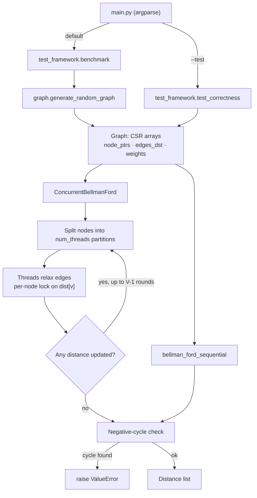

# ⚡ Concurrent Shortest Path Finder (Bellman-Ford)

> A pure-Python single-source shortest path engine that runs Bellman-Ford sequentially and in parallel with a thread pool, handles negative edge weights, and detects negative-weight cycles.


---

## ✨ Features

- **Two solvers with the same output**
  - `bellman_ford_sequential(graph, source)`: classic Bellman-Ford with early exit once an iteration makes no update.
  - `ConcurrentBellmanFord(graph, source, num_threads).run()`: splits nodes into equal partitions and relaxes their outgoing edges in parallel with `concurrent.futures.ThreadPoolExecutor`.
- **Fine-grained locking**: one `threading.Lock` per node, so a thread only locks the destination distance it is updating.
- **Negative weights supported**, with **negative-cycle detection** through an extra relaxation pass that raises `ValueError("Graph contains a negative weight cycle")`.
- **CSR-style graph storage**: edges are kept in flat `edges_dst` / `weights` arrays, sorted per source node and indexed by `node_ptrs`, for cache-friendly traversal.
- **Random graph generator** (`generate_random_graph`) with configurable size, edge probability, weight range, and an optional ~10% share of negative edges.
- **Built-in benchmark CLI** that times the sequential and concurrent solvers on the same graph and counts distance mismatches.
- **Graph files from the CLI**: `python main.py --input sample/input.txt` solves a graph written as `<nodes> <edges>` then `u v w` per line and prints one distance per node (`INF` if unreachable).
- **Unit tests** (8) for a standard mixed-weight graph, negative-cycle detection (both solvers), disconnected and zero-edge graphs, the single-node case, a large sparse graph, repeatability of the concurrent solver, and the `sample/` input/output pair.

## 🛠 Tech Stack

| Area | Tools |
|---|---|
| Language | Python 3 (standard library only at runtime) |
| Concurrency | `concurrent.futures.ThreadPoolExecutor`, `threading.Lock` |
| CLI | `argparse` |
| Testing | `unittest` |
| Scripting | PowerShell (`run_all.ps1`) |

## 🏗 How it works



## 📂 Project Structure

```
Shortest-path-finder/
├── graph.py                  # Graph class (CSR-like storage) + random graph generator
├── bellman_ford.py           # Sequential and concurrent Bellman-Ford
├── main.py                   # CLI: correctness check or benchmark
├── test_framework.py         # test_correctness() and benchmark()
├── test_unit.py              # unittest suite
├── utils.py                  # load_graph() for sample/input.txt-style files, format_distance()
├── benchmark.py              # Reproducible benchmark that prints a Markdown table
├── run_all.ps1               # Runs unit tests, a 2,000-node benchmark, and the correctness check
├── sample/
│   ├── input.txt             # Example graph: "<nodes> <edges>" then "u v w" per line
│   └── output.txt            # Expected distances from node 0 for that graph
├── Design_document.md        # Design notes
├── performance_report        # Measured benchmark results and analysis
├── reflection_future _works  # Reflection and future-work notes
├── output_utf8.md            # Captured console output of run_all.ps1
├── requirements.txt          # Runtime: none (standard library only)
└── requirements-dev.txt      # pytest (optional test runner)
```

## 🚀 Getting Started

```bash
git clone https://github.com/Gonugunta-Venkata-Jayanth/Shortest-path-finder.git
cd Shortest-path-finder
```

No third-party packages are needed to run the solver or the tests. `pip install -r requirements-dev.txt` adds `pytest` if you prefer it to `unittest`.

### Solve a graph file

```bash
python main.py --input sample/input.txt            # prints 0 6 7 11 9, one per line (matches sample/output.txt)
python main.py --input my_graph.txt --source 2     # pick another source node
```

### Correctness check

```bash
python main.py --test
```

### Benchmark sequential vs concurrent

```bash
python main.py --nodes 2000 --edge_prob 0.01 --threads 8 --allow_negative
```

| Flag | Default | Meaning |
|---|---|---|
| `--nodes` | `1000` | Number of nodes in the random graph |
| `--edge_prob` | `0.01` | Probability of an edge between any ordered pair of nodes |
| `--threads` | `8` | Worker threads for the concurrent solver |
| `--allow_negative` | off | Makes ~10% of edges negative |
| `--test` | off | Runs the correctness check instead of the benchmark |
| `--input` | none | Solve this graph file instead of a random graph |
| `--source` | `0` | Source node for `--input` |
| `--seed` | none | Seed the random graph for a reproducible benchmark |

### Unit tests

```bash
python -m unittest test_unit.py -v
```

### Reproducible benchmark table

```bash
python benchmark.py --repeats 3
```

### Everything at once (Windows PowerShell)

```powershell
./run_all.ps1
```

### Use it as a library

```python
from graph import Graph
from bellman_ford import bellman_ford_sequential, ConcurrentBellmanFord

edges = [(0, 1, 5), (0, 2, 3), (1, 2, 2), (1, 3, 6), (2, 3, 7), (2, 4, 4), (3, 4, -1)]
g = Graph(5, edges)

print(bellman_ford_sequential(g, 0))                 # [0.0, 5.0, 3.0, 10.0, 7.0]
print(ConcurrentBellmanFord(g, 0, num_threads=4).run())
```

## 📊 Results

- All 8 unit tests pass (`python -m unittest test_unit -v`).
- Both solvers return `[0.0, 5.0, 3.0, 10.0, 7.0]` on the reference graph and both detect negative cycles.
- Measured with `benchmark.py` (see `performance_report` for the full table): the concurrent solver gives the same distances as the sequential one, but is **slower** in every case measured (about 0.08x-0.27x of sequential speed). Example: 1,000 nodes / 9,940 edges with ~10% negative edges, 8 threads: sequential 1.16 s, concurrent 4.33 s.

Because of CPython's Global Interpreter Lock (GIL), CPU-bound relaxation in threads plus per-edge locking is slower than the sequential loop. The future-work items below target this.

## 🔮 Future Work

- Use `multiprocessing` / shared memory, or a C/C++/Rust extension, to get around the GIL.
- Replace per-edge locking with lock-free per-thread buffers that are merged once per round.
- Add work-stealing for uneven degree distributions, plus other algorithms (e.g. parallel Dijkstra / Δ-stepping for non-negative weights).
- Add CI (GitHub Actions) to run the test suite on every push.

## 👤 Author

**Jayanth Gonugunta Venkata**: [github.com/Gonugunta-Venkata-Jayanth](https://github.com/Gonugunta-Venkata-Jayanth)
